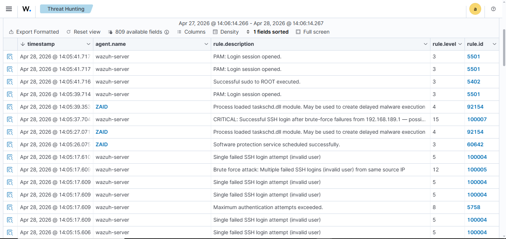
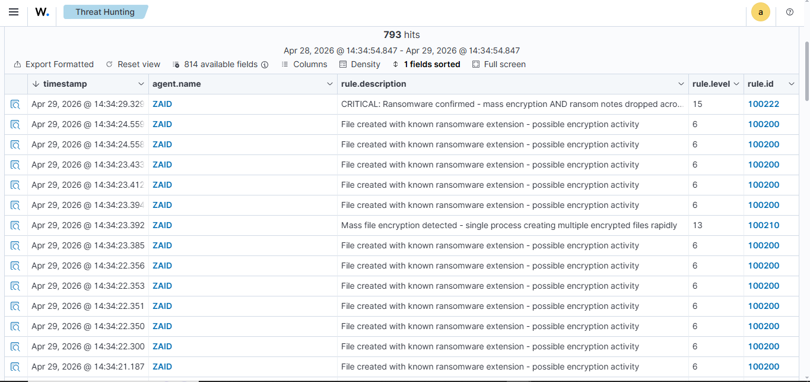
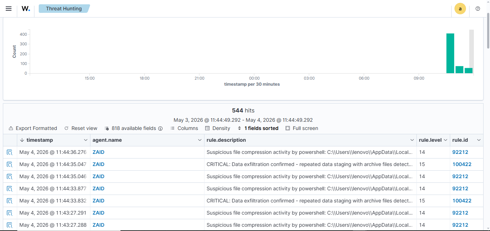
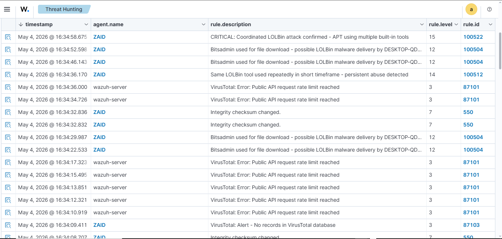
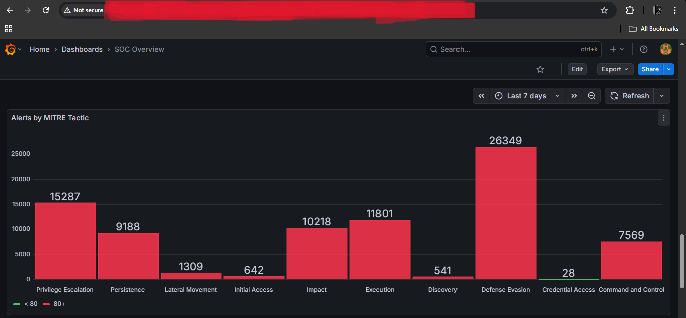
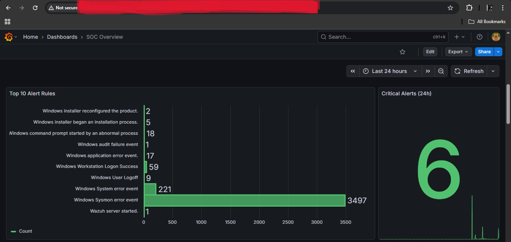
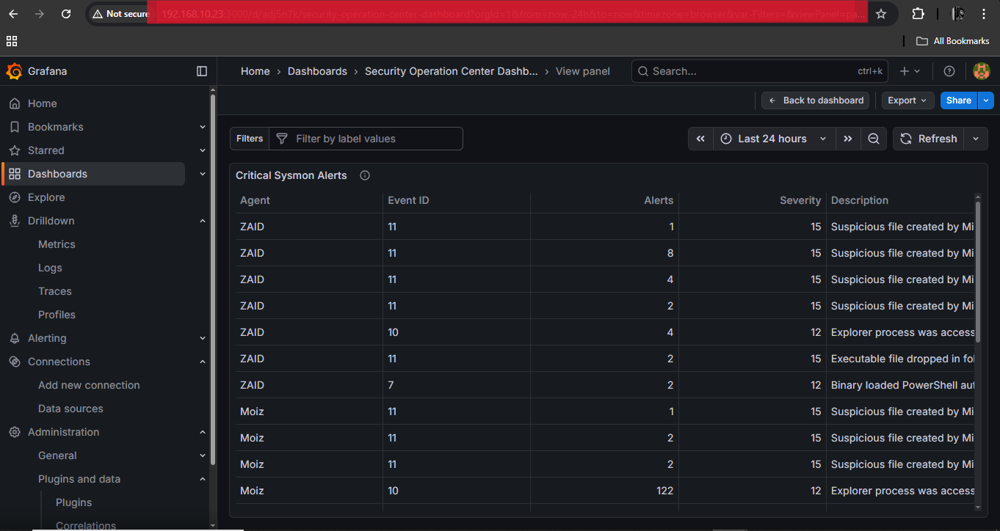
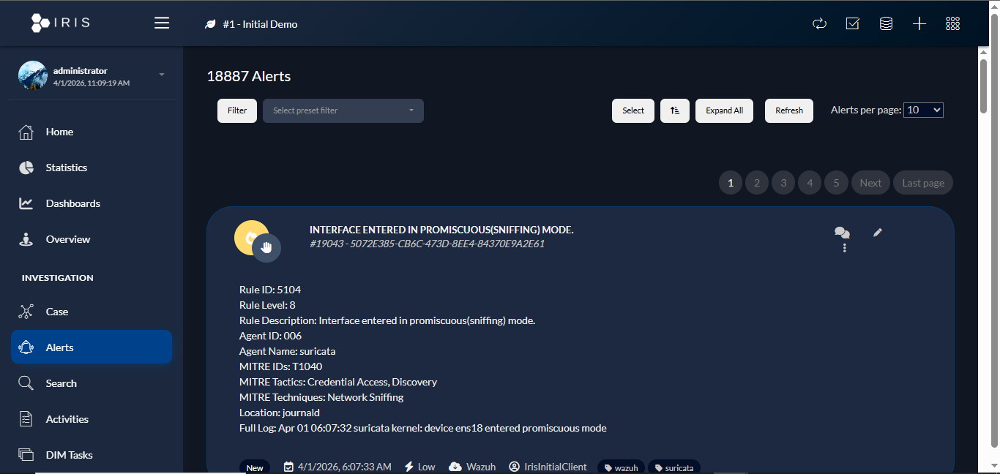
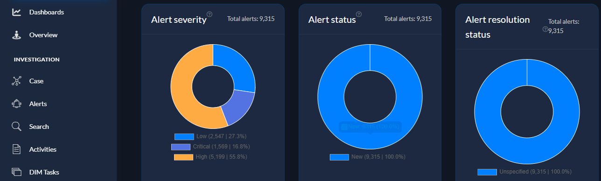

# wazuh-siem-lab

Custom Wazuh correlation rules mapped to MITRE ATT&CK, built and tested in a personal lab with Sysmon endpoint telemetry.

## Use cases
| Use case | Rules | ATT&CK | Folder |
|---|---|---|---|
| Brute force and login success | 6 | T1110, T1078 | `rules/brute-force/` |
| Ransomware behavior | 11 | T1486, T1490, T1070.004 | `rules/ransomware/` |
| Process injection | 8 | T1055 | `rules/process-injection/` |
| Data exfiltration | 9 | T1048, T1560, T1059.001 | `rules/exfiltration/` |
| LOLBins abuse | 13 | T1218, T1003.001, T1105, T1197 | `rules/lolbins/` |

Every use case follows the same three stages: single-event catchers, frequency escalation, and critical correlation.

## Lab stack
- **Wazuh SIEM:** manager on Kali Linux, Windows endpoint agent
- **Sysmon:** endpoint telemetry feeding the rules
- **VirusTotal:** automated enrichment of suspicious files
- **Grafana:** security dashboards
- **IRIS:** incident and case tracking

## Evidence
Alerts fired by the custom rules in the lab (Wazuh dashboard):

**Brute force**

**Ransomware behavior**

**Data exfiltration**

**LOLBins abuse**

## Dashboards
Grafana dashboards built on Wazuh alert data from the lab. [See all six](docs/dashboards.md).

**Alerts by MITRE ATT&CK tactic**

**Top 10 alerts by rule**

**Critical Sysmon alerts**

## Case management
Wazuh alerts are forwarded to IRIS for case tracking.

**Wazuh alert in IRIS, with ATT&CK tactics**

**Alert severity breakdown in IRIS**

## Repository structure
- `rules/`: custom Wazuh rules (XML), one folder per use case
- `sysmon/`: Sysmon configuration additions the rules depend on
- `tests/`: safe test commands for each rule
- `docs/`: dashboards and supporting images

## Known limitations
- Tests simulate behavior and verify the rules fire; they are not live malware.
- 8 of 13 LOLBin rules were verified in the lab; the rest target tools unavailable on the test host.
- Thresholds need tuning against real-world noise before production use.

## Disclaimer
All data comes from a personal lab. No employer data is included. For defensive use only.

## License
MIT
