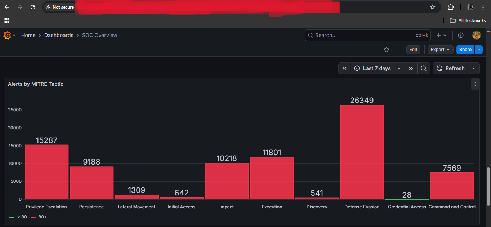
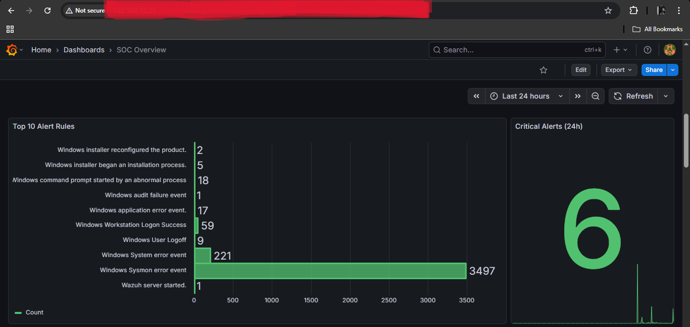
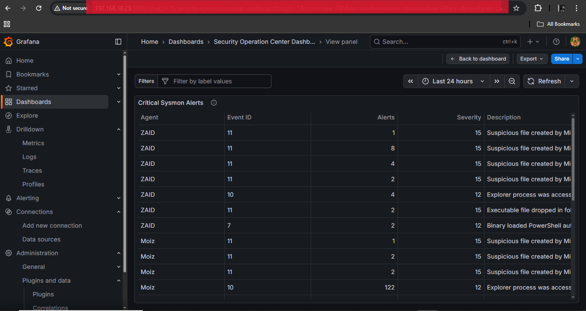
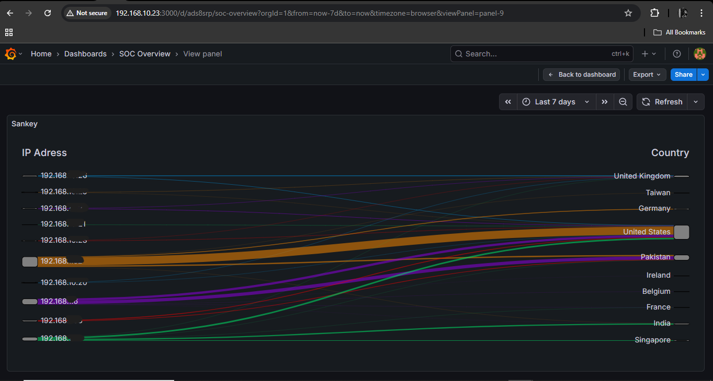
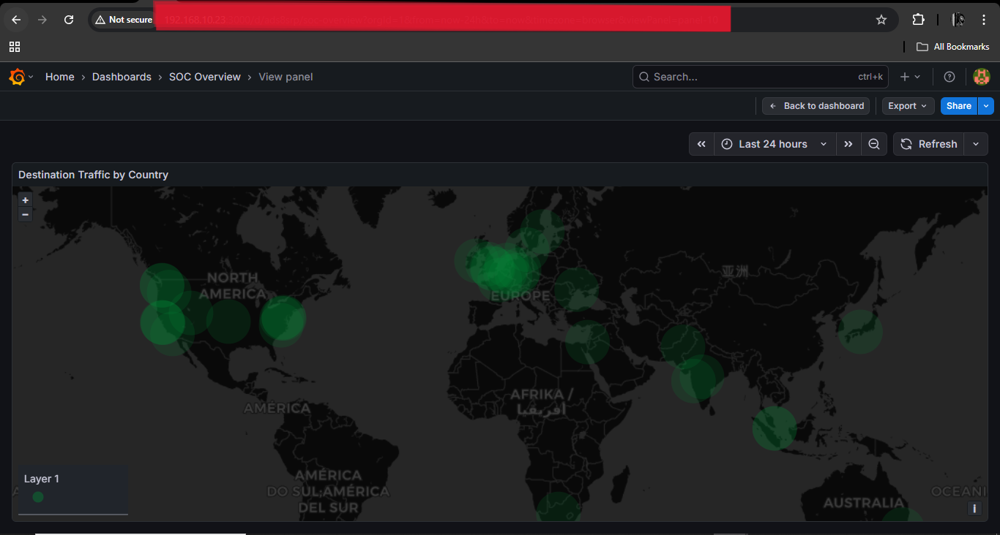
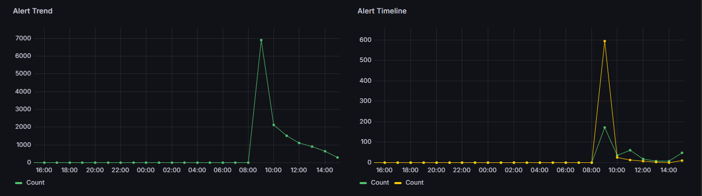

# Grafana dashboards

Security dashboards built on Wazuh alert data from the lab.

## Alerts by MITRE ATT&CK tactic
Alert counts grouped by ATT&CK tactic, showing which stages of an attack the rules are catching.

## Top 10 alerts by rule
The most frequently firing rules, including the custom detections.

## Critical Sysmon alerts
High-severity alerts generated from Sysmon endpoint telemetry.

## Source IPs to countries (Sankey)
Flow of source IP addresses to their countries of origin.

## Geolocation map
Geographic view of connection sources.

## Alert trend and timeline
Alert volume over time, used to spot spikes and attack windows.

